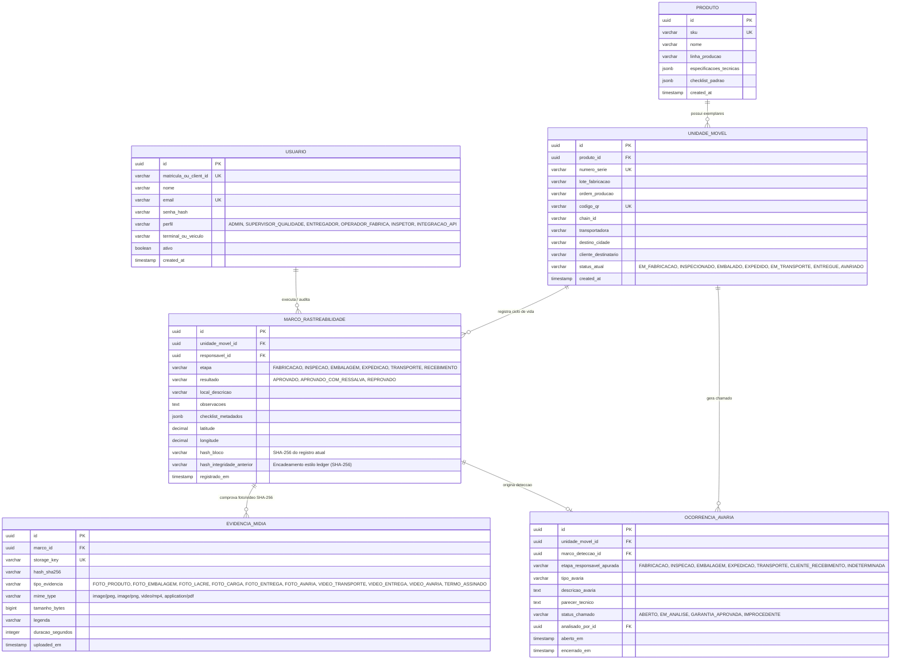

# Documentação Técnica: Sistema de Rastreabilidade MovSeg

**Móveis Matos & Lopes Ltda.** (Ponte Nova/MG • Projeto Integrador SENAI CFP São Vicente de Paulo)  
**Status do Documento:** Especificação Atualizada & Implementação Monorepo (Versão 2.0)

---

## 1. Visão Geral e Contexto do Projeto

O **MovSeg** é um sistema de rastreabilidade industrial, logística e de pós-venda voltado para o controle rigoroso da qualidade, integridade de embalagem e registro imutável de marcos operacionais da **Móveis Matos & Lopes Ltda.**

### O Problema Central
O fluxo do móvel compreende 6 etapas obrigatórias: **Fabricação, Inspeção, Embalagem, Expedição, Transporte e Recebimento no Cliente**. Sem um histórico consolidado por evidências fotográficas, vídeos e marcações temporais confiáveis, a empresa não consegue comprovar se uma avaria ocorreu na fábrica, no carregamento, no transporte ou no recebimento final, assumindo custos indevidos com assistências técnicas, peças de reposição e fretes repetitivos.

### Objetivo e Premissa Base de Negócio
Registrar de forma simples, temporal e inviolável as condições físicas do produto e de sua embalagem em cada transição de etapa, adotando uma **separação clara de responsabilidades entre plataformas**:

- **Aplicativo Mobile (Flutter — Perfil `ENTREGADOR`):** Forma oficial de **fotografar e gravar vídeos** dos móveis durante o processo de transporte (`TRANSPORTE`) e entrega final (`RECEBIMENTO`), aproveitando a praticidade da câmera e do GPS de dispositivos móveis em campo.
- **Portal Web (Next.js — Perfil `ADMIN` / `SUPERVISOR_QUALIDADE`):** Focado no perfil dos **administradores**, centralizando o acompanhamento da cadeia de custódia, cadastro de catálogo/lotes/etiquetas QR, governança de checklists dinâmicos, apuração técnica de ocorrências de avaria, indicadores gerenciais e auditoria criptográfica do ledger.
- **Backend Centralizado (Java 21 + Spring Boot + PostgreSQL):** Fonte única de verdade que impõe o controle de acesso (RBAC), bloqueia registros de transporte/entrega fora do perfil de campo, calcula o encadeamento SHA-256 dos blocos e armazena as evidências de imagem e vídeo.

---

## 2. Estrutura do Monorepo e Pilha Tecnológica

O repositório segue uma organização convencional de monorepo desacoplada por responsabilidade:

```text
ProjetoFinal-MovSeg/
├── backend/            # API REST centralizada (Java 21, Spring Boot 3.4, Gradle, Flyway, PostgreSQL)
├── web/                # Portal Web Administrativo e Passaporte Público (Next.js 15, TypeScript, Tailwind CSS)
├── mobile/             # Aplicativo Mobile dos Entregadores (Flutter 3, Dart, ImagePicker, Geolocator)
├── docker-compose.yml  # Infraestrutura local (PostgreSQL 16 + MinIO Object Storage)
└── README.md           # Documentação técnica e guia operacional
```

### Pilha Tecnológica
- **Backend (`backend/`):** Java 21 + **Spring Boot 3.4** (Spring Web, Spring Data JPA, Spring Security + JWT, Bean Validation, Flyway, Springdoc OpenAPI).
- **Banco de Dados:** **PostgreSQL** com colunas `JSONB` para especificações técnicas e checklists dinâmicos, além de triggers `BEFORE UPDATE OR DELETE` garantindo comportamento *append-only* (WORM).
- **Armazenamento de Mídia:** Armazenamento de objetos compatível com S3/MinIO (com abstração local em `./storage/evidences` para execução imediata sem dependências externas) vinculado por hashes `SHA-256`, suportando **fotos (`image/*`), vídeos (`video/mp4`, etc.) e termos (`application/pdf`)**.
- **Web Administrativo (`web/`):** **Next.js 15** (App Router), React 19, TypeScript e Tailwind CSS v4.
- **Mobile Entregadores (`mobile/`):** **Flutter** (Dart) com captura oficial de câmera (foto e vídeo), cálculo local de SHA-256, geolocalização GPS e exibição de QR Code para validação pelo cliente.

---

## 3. Identidade Visual e Design System (**DeepSea Industrial Ledger**)

Para assegurar legibilidade em ambientes fabris, docas de expedição e painéis gerenciais, adota-se a paleta **DeepSea**:

| Token / Papel | Código Hex | Aplicação Principal |
| :--- | :--- | :--- |
| **DeepSea Primary** | `#001026` / `#0B2545` | Barras de navegação, cabeçalhos, botões principais e selos WORM. |
| **DeepSea Secondary** | `#134074` / `#395F95` | Estados ativos, bordas em foco, progresso de custódia e destaques. |
| **DeepSea Accent** | `#8DA9C4` / `#9DC3FF` | Divisores, badges secundários e bordas sutis de cartões. |
| **DeepSea Canvas (Fundo)** | `#F4FAFE` / `#EEF4F8` | Fundo de dashboards e áreas de leitura de alto contraste. |
| **DeepSea Dark (Texto)** | `#04151F` / `#161C1F` | Títulos, identificadores de série e textos principais. |
| **Feedback Success** | `#2A9D8F` | Marcos aprovados sem avarias e integridade SHA-256 validada. |
| **Feedback Alert / Error** | `#E76F51` / `#BA1A1A` | Divergências detectadas, avarias e quebras de cadeia. |

- **Tipografia:** `Space Grotesk` (títulos e métricas), `Work Sans` (textos e descrições) e `JetBrains Mono` (SKUs, QR Codes, carimbos temporais e hashes SHA-256).

---

## 4. Requisitos Funcionais, Papéis e Restrições

### Separação de Perfis
- **`ADMIN` / `SUPERVISOR_QUALIDADE` (Web):** Gerencia catálogo de produtos, gera unidades rastreáveis e etiquetas QR, edita templates dinâmicos de checklists, registra etapas fabris internas quando aplicável, analisa ocorrências (`OCORRENCIA_AVARIA`), atribui a etapa de origem apurada e consulta indicadores analíticos. Não registra etapas de `TRANSPORTE` ou `RECEBIMENTO` (regra imposta pela API com HTTP `403`).
- **`ENTREGADOR` (Mobile):** Acessa unidades em rota por QR Code/Lote, fotografa e grava vídeos oficiais do móvel durante `TRANSPORTE` e `RECEBIMENTO`, preenche o checklist de entrega, anexa coordenadas GPS e reporta eventuais avarias no ato da descarga.
- **`OPERADOR_FABRICA` / `INSPETOR`:** Registra os marcos internos (`FABRICACAO`, `INSPECAO`, `EMBALAGEM`, `EXPEDICAO`).
- **Cliente Final / Auditor Externo (Público sem Login):** Consulta o passaporte digital via `/rastreio/{codigoQr}` com mascaramento de dados pessoais em conformidade com a **LGPD**.

### Requisitos Funcionais Principais
- **RF01:** Autenticação JWT com separação de acesso por plataforma (Web Admin vs. Mobile Entregador).
- **RF02:** Cadastro de produtos, especificações técnicas e checklists dinâmicos (`JSONB`).
- **RF03:** Emissão de unidades rastreáveis (`UNIDADE_MOVEL`) com código QR e `chain_id` exclusivos.
- **RF04:** Registro sequencial e imutável dos 6 marcos (`FABRICACAO`, `INSPECAO`, `EMBALAGEM`, `EXPEDICAO`, `TRANSPORTE`, `RECEBIMENTO`) com encadeamento SHA-256.
- **RF05:** Upload e streaming de evidências fotográficas e **em vídeo** com hash SHA-256 individual.
- **RF06:** Abertura automática de `OCORRENCIA_AVARIA` quando um marco é registrado com `REPROVADO` ou `houveAvaria = true`.
- **RF07:** Triagem e parecer técnico de ocorrências no Portal Web com atribuição da etapa responsável (`FABRICACAO` a `CLIENTE_RECEBIMENTO`) e decisão (`GARANTIA_APROVADA`, `IMPROCEDENTE`).
- **RF08:** Dashboard gerencial com taxa de integridade e agrupamentos por origem da avaria, linha de produto, tipo de dano e transportadora.
- **RF09:** Revalidação da árvore de Merkle / cadeia SHA-256 e consulta pública LGPD via QR Code.

### Restrições Arquiteturais Atendidas
- **Arquitetura Aberta e Baixo Custo:** Construído 100% com tecnologias open-source (Java/Spring, PostgreSQL, Next.js, Flutter), pronto para integração futura com ERP via REST/OpenAPI.
- **Independência de Registros:** Marcos internos e de entrega são obrigatórios e auditáveis independentemente de ação do cliente final.
- **Proteção LGPD:** O endpoint público `/api/v1/publico/rastreio/{codigoQr}` mascara o nome completo do destinatário e não expõe dados comerciais sensíveis.

---

## 5. Modelo de Dados (DER)



### Diretrizes de Imutabilidade no Banco de Dados
- **WORM (`MARCO_RASTREABILIDADE` e `EVIDENCIA_MIDIA`):** Definido em [V1__init_schema.sql](file:///backend/src/main/resources/db/migration/V1__init_schema.sql) com triggers PostgreSQL (`trg_marco_imutavel` e `trg_evidencia_imutavel`) que bloqueiam qualquer `UPDATE` ou `DELETE`.
- **Encadeamento Criptográfico:** Cada bloco armazena `hash_integridade_anterior` (64 zeros no bloco gênesis) e `hash_bloco` (SHA-256 determinístico), permitindo cálculo de *Merkle Root* e detecção imediata de adulterações.

---

## 6. Como Executar o Projeto

### 1. Infraestrutura (PostgreSQL + MinIO)
```bash
docker compose up -d
```
*(Ou utilize uma instância PostgreSQL local com o banco `movseg` configurado nas variáveis `DB_URL`, `DB_USER` e `DB_PASSWORD`.)*

### 2. Backend Centralizado (`backend/`)
```bash
cd backend
./gradlew bootRun        # Linux/macOS
.\gradlew.bat bootRun    # Windows
```
- API disponível em `http://localhost:8080`
- Swagger UI: `http://localhost:8080/swagger-ui.html`
- Executar testes automatizados: `.\gradlew.bat test`

### 3. Portal Web Administrativo (`web/`)
```bash
cd web
npm install
npm run dev
```
- Acesse `http://localhost:3000` (login administrativo) ou `http://localhost:3000/rastreio/MOV-SEC-8893-XP` (passaporte público).

### 4. Aplicativo Mobile dos Entregadores (`mobile/`)
```bash
cd mobile
flutter pub get
flutter run --dart-define=API_URL=http://10.0.2.2:8080
```
*(Para rodar no navegador ou desktop local: `flutter run -d chrome --dart-define=API_URL=http://localhost:8080`.)*

### Credenciais de Demonstração (Seed Inicial)
| Perfil | E-mail | Senha | Plataforma |
| :--- | :--- | :--- | :--- |
| **Administrador (`ADMIN`)** | `admin@movseg.com.br` | `MovSeg@2026` | Portal Web (`web/`) |
| **Entregador (`ENTREGADOR`)** | `entregador@movseg.com.br` | `MovSeg@2026` | App Mobile (`mobile/`) |
| **Inspetora CQ (`INSPETOR`)** | `inspetor@movseg.com.br` | `MovSeg@2026` | Portal Web (`web/`) |
