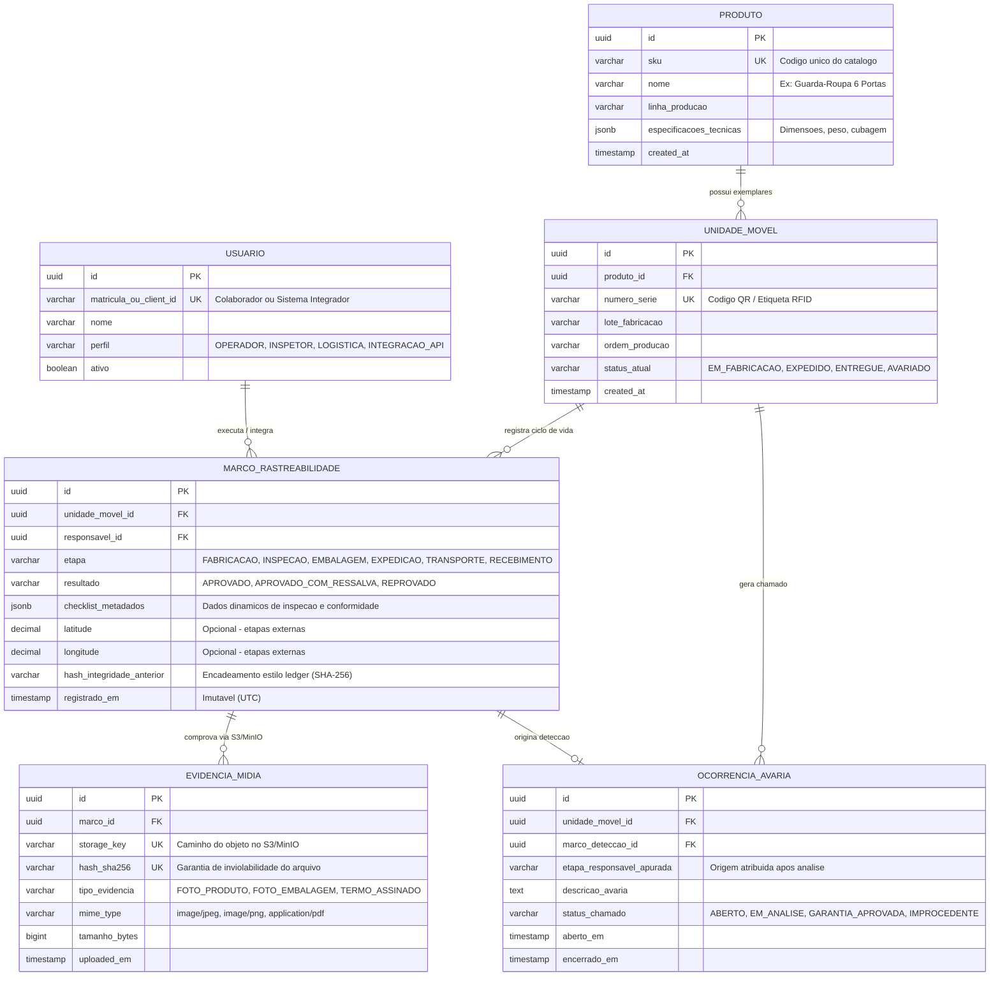

# Documentação Técnica: Sistema de Rastreabilidade MovSeg
**Móveis Matos & Lopes Ltda.**  
**Autor:** Arquiteto de Software Sênior & Analista de Sistemas  
**Status do Documento:** Pronto para Implementação (Versão 1.1)  

---

## 1. Visão Geral e Contexto do Projeto

O **MovSeg** é um sistema de rastreabilidade industrial e de pós-venda voltado para o controle rigoroso da qualidade, conformidade de embalagem e registro de marcos logísticos da Móveis Matos & Lopes Ltda. 

### O Problema Central
Atualmente, o fluxo do móvel compreende as etapas de **Fabricação, Inspeção, Embalagem, Expedição, Transporte e Recebimento no Cliente**. A ausência de um histórico consolidado — composto por evidências foto-documentais e marcações temporais confiáveis — impede a apuração precisa de responsabilidades em casos de avarias e divergências. Consequentemente, a empresa assume custos logísticos e de substituição indevidos sem confirmar a origem real da falha (seja falha produtiva, de embalagem, transporte ou manuseio no recebimento).

### Objetivo do Sistema
Registrar de forma simples, temporal e inviolável as condições físicas do produto e de sua embalagem em cada transição de etapa, fornecendo uma base única de consulta para o suporte técnico, engenharia de qualidade e gestão logística, agilizando decisões de garantia e mitigando perdas financeiras.

---

## 2. Arquitetura de Software e Tecnologias

O sistema foi desenhado seguindo uma arquitetura em camadas (Model-View-Controller / Arquitetura Limpa em microsserviço monolítico modular), garantindo alta coesão e facilidade de manutenção.

### Pilha Tecnológica
- **Backend:** Java 17+ com **Spring Boot** (Spring Data JPA, Spring Web, Spring Security, Validation).
- **Banco de Dados:** **PostgreSQL** (com suporte a JSONB para metadados dinâmicos de inspeção e restrições de imutabilidade/auditoria).
- **Documentação e Versionamento:** Markdown (`README.md`), seguindo os padrões de legibilidade exigidos para repositórios corporativos.
- **Armazenamento de Mídia:** Object Storage (ex: AWS S3 ou MinIO compatível) para armazenamento seguro de evidências fotográficas vinculadas por hashes criptográficos (`SHA-256`).

---

## 3. Identidade Visual e UI (Paleta **DeepSea**)

Para manter a consistência visual em relatórios gerenciais e nas telas operacionais, adota-se a paleta **DeepSea**, que transmite rigidez técnica, segurança e confiabilidade industrial.

| Cor / Token | Código Hexadecimal | Aplicação Principal na Interface / Relatórios |
| :--- | :--- | :--- |
| **DeepSea Primary** | `#0B2545` | Barras de navegação, cabeçalhos de tabelas, botões principais de ação. |
| **DeepSea Secondary** | `#134074` | Destaques secundários, bordas de componentes ativos, ícones de navegação. |
| **DeepSea Accent** | `#8DA9C4` | Elementos de seleção, tags de status intermediários, gráficos e divisores. |
| **DeepSea Light (Fundo)** | `#EEF4F8` | Plano de fundo de dashboards, áreas de trabalho e cartões de métricas. |
| **DeepSea Dark (Texto)** | `#04151F` | Títulos, textos principais e rótulos de formulários de inspeção. |
| **Feedback Success** | `#2A9D8F` | Marcos de validação aprovados sem avarias nas etapas. |
| **Feedback Alert/Error** | `#E76F51` | Alertas de divergência, avarias detectadas e chamados de assistência abertos. |

---

## 4. Requisitos Funcionais e Fluxo de Rastreabilidade

O ciclo de vida de rastreio de um móvel engloba 6 marcos obrigatórios. Cada marco gera um registro imutável contendo carimbo de data/hora (`timestamp`), geolocalização (quando aplicável) e ID do colaborador ou sistema integrador responsável.

---

## 5. Modelo de Dados (DER)

A modelagem relacional abaixo estrutura a rastreabilidade ponta a ponta no **PostgreSQL**. O modelo separa os dados mestres do produto (`PRODUTO` e `UNIDADE_MOVEL`) dos eventos append-only (`MARCO_RASTREABILIDADE`), garantindo integridade referencial, suporte a checklists dinâmicos via `JSONB` e vinculação criptográfica com as evidências armazenadas no Object Storage.

### Diretrizes de Implementação no Banco de Dados
- **Imutabilidade (`MARCO_RASTREABILIDADE` e `EVIDENCIA_MIDIA`):** Triggers no PostgreSQL devem bloquear operações de `UPDATE` e `DELETE` nessas tabelas, assegurando comportamento estritamente *append-only*.
- **Encadeamento Criptográfico:** O campo `hash_integridade_anterior` permite validar que nenhum marco intermediário foi adulterado ou removido da linha do tempo do móvel.
- **Flexibilidade de Inspeção:** O atributo `checklist_metadados` (`JSONB`) acomoda diferentes critérios de qualidade por linha de móveis sem exigir alterações estruturais (*migrations*) a cada novo produto lançado.