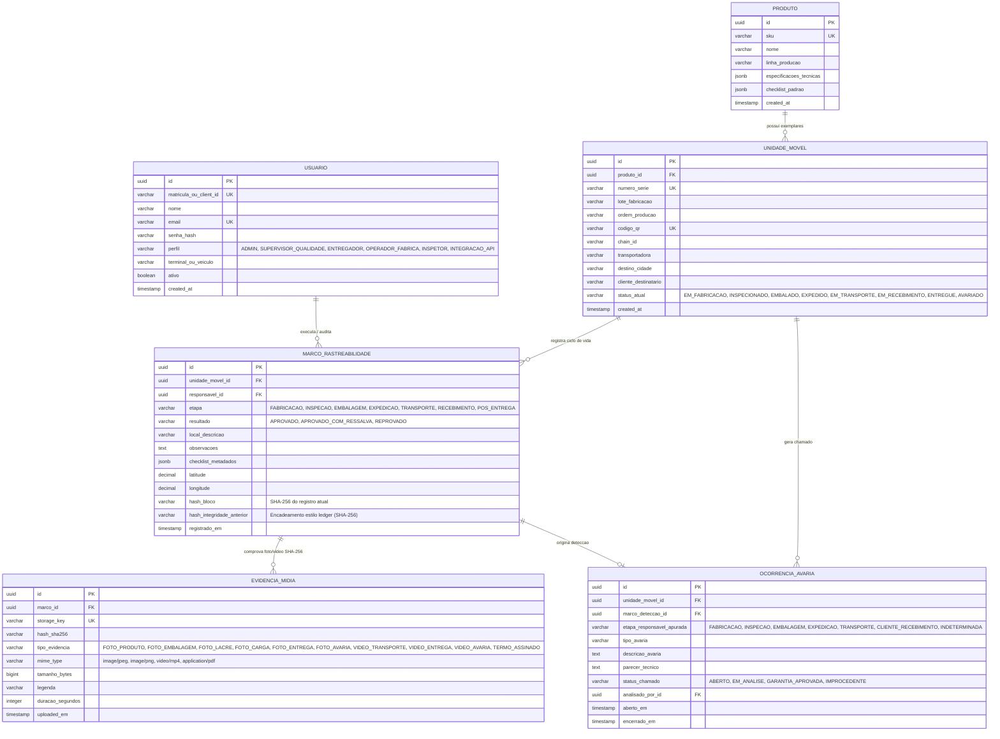

# Documentação Técnica: Sistema de Rastreabilidade MovSeg

**Móveis Matos & Lopes Ltda.** (Ponte Nova/MG • Projeto Integrador SENAI CFP São Vicente de Paulo)  
**Status do Documento:** Implementação do sistema de coleta e acompanhamento

---

## 1. Visão Geral e Contexto do Projeto

O **MovSeg** é um sistema de rastreabilidade industrial, logística e de pós-venda voltado para o controle rigoroso da qualidade, integridade de embalagem e registro imutável de marcos operacionais da **Móveis Matos & Lopes Ltda.**

### O Problema Central
O fluxo reúne três marcos internos (**Fabricação**, **Inspeção** e **Embalagem**) e quatro pontos de coleta (**Saída da fábrica**, **Antes da entrega**, **Chegada ao cliente** e **Após a entrega**). A comparação das evidências ajuda a equipe a identificar em que intervalo o estado do móvel ou da embalagem mudou e a fundamentar o parecer técnico de assistência.

### Objetivo e Premissa Base de Negócio
Cada registro associa a unidade à etapa, ao responsável, ao horário e aos arquivos enviados.

- **Aplicativo móvel (Flutter):** Operadores e inspetores registram as etapas internas. Entregadores registram a carga antes da entrega, a chegada e a condição após a entrega. O aplicativo usa a câmera do celular e coleta a localização conforme a etapa e as permissões.
- **Portal web (Next.js):** A tela `/painel` reúne as unidades por ordem de produção. A equipe autorizada consulta as evidências, analisa ocorrências e acompanha indicadores. A tela `/rastreio` oferece a consulta pública pelo código da etiqueta.
- **API (Java 21 + Spring Boot + PostgreSQL):** Valida os perfis e a sequência de etapas, armazena os arquivos e calcula o encadeamento SHA-256 para detectar alterações.

---

## 2. Estrutura do Monorepo e Pilha Tecnológica

O repositório segue uma organização convencional de monorepo desacoplada por responsabilidade:

```text
ProjetoFinal-MovSeg/
├── backend/            # API REST centralizada (Java 21, Spring Boot 3.4, Gradle, Flyway, PostgreSQL)
├── web/                # Portal Web Administrativo e Passaporte Público (Next.js 15, TypeScript, Tailwind CSS)
├── mobile/             # Aplicativo Mobile dos Entregadores (Flutter 3, Dart, ImagePicker, Geolocator)
├── docker-compose.yml  # Infraestrutura local (PostgreSQL 16 + MinIO Object Storage)
└── README.md           # Documentação técnica e guia operacional
```

### Pilha Tecnológica
- **Backend (`backend/`):** Java 21 + **Spring Boot 3.4** (Spring Web, Spring Data JPA, Spring Security + JWT, Bean Validation, Flyway, Springdoc OpenAPI).
- **Banco de Dados:** **PostgreSQL** com colunas `JSONB` para especificações técnicas e checklists dinâmicos, além de triggers `BEFORE UPDATE OR DELETE` garantindo comportamento *append-only* (WORM).
- **Armazenamento de mídia:** A API grava em `./storage/evidences` por padrão. Use `STORAGE_DIR` para configurar um volume persistente. Os marcos exigem uma foto ou um vídeo nos formatos aceitos pela API.
- **Web Administrativo (`web/`):** **Next.js 15** (App Router), React 19, TypeScript e Tailwind CSS v4.
- **Mobile Entregadores (`mobile/`):** **Flutter** (Dart) com captura oficial de câmera (foto e vídeo), cálculo local de SHA-256, geolocalização GPS e exibição de QR Code para validação pelo cliente.

---

## 3. Identidade visual MovSeg

O portal e o aplicativo usam a logo MovSeg e a paleta fornecida.

| Token / Papel | Código Hex | Aplicação Principal |
| :--- | :--- | :--- |
| Azul-noite | `#0D1321` | Navegação e textos principais. |
| Azul-marinho | `#1F2B42` | Botões principais e superfícies escuras. |
| Azul-aço | `#405A74` | Links, ícones e foco. |
| Azul-acinzentado | `#768AA7` | Bordas e detalhes visuais. |
| Creme | `#EEEBDA` | Superfícies claras e contraste em superfícies escuras. |

- **Tipografia:** `Space Grotesk` (títulos e métricas), `Work Sans` (textos e descrições) e `JetBrains Mono` (SKUs, QR Codes, carimbos temporais e hashes SHA-256).

---

## 4. Requisitos Funcionais, Papéis e Restrições

### Separação de Perfis
- **`ADMIN` / `SUPERVISOR_QUALIDADE` (web):** Gerencia catálogo, etiquetas e checklists, apura a origem das avarias e consulta indicadores. Os perfis também podem registrar etapas internas.
- **`ENTREGADOR` (mobile):** Identifica a unidade pela etiqueta ou número de série e registra `TRANSPORTE`, `RECEBIMENTO` e `POS_ENTREGA`.
- **`OPERADOR_FABRICA` / `INSPETOR` (mobile):** Registra os marcos internos `FABRICACAO`, `INSPECAO`, `EMBALAGEM` e `EXPEDICAO`.
- **Consulta pública:** Mostra produto, situação, etapas e horários vinculados à etiqueta.

### Requisitos Funcionais Principais
- **RF01:** Autenticação JWT com separação de acesso por plataforma (Web Admin vs. Mobile Entregador).
- **RF02:** Cadastro de produtos, especificações técnicas e checklists dinâmicos (`JSONB`).
- **RF03:** Emissão de unidades rastreáveis (`UNIDADE_MOVEL`) com código QR e `chain_id` exclusivos.
- **RF04:** Registro sequencial de sete marcos (`FABRICACAO`, `INSPECAO`, `EMBALAGEM`, `EXPEDICAO`, `TRANSPORTE`, `RECEBIMENTO`, `POS_ENTREGA`) com encadeamento SHA-256.
- **RF05:** Upload e streaming de evidências fotográficas e **em vídeo** com hash SHA-256 individual.
- **RF06:** Abertura automática de `OCORRENCIA_AVARIA` quando um marco é registrado com `REPROVADO` ou `houveAvaria = true`.
- **RF07:** Triagem e parecer técnico de ocorrências no Portal Web com atribuição da etapa responsável (`FABRICACAO` a `CLIENTE_RECEBIMENTO`) e decisão (`GARANTIA_APROVADA`, `IMPROCEDENTE`).
- **RF08:** Indicadores de avarias por origem apurada, linha de produto, tipo, cliente e transportadora.
- **RF09:** Revalidação da árvore de Merkle / cadeia SHA-256 e consulta pública LGPD via QR Code.

### Restrições Arquiteturais Atendidas
- **Arquitetura Aberta e Baixo Custo:** Construído 100% com tecnologias open-source (Java/Spring, PostgreSQL, Next.js, Flutter), pronto para integração futura com ERP via REST/OpenAPI.
- **Independência de Registros:** Marcos internos e de entrega são obrigatórios e auditáveis independentemente de ação do cliente final.
- **Controle de dados:** A consulta pública usa uma resposta reduzida. Fotos, observações internas e dados do destinatário ficam fora dessa resposta. A mídia exige autenticação.

---

## 5. Modelo de Dados (DER)



### Diretrizes de Imutabilidade no Banco de Dados
- **Registros somente para inclusão:** As tabelas de marcos e evidências usam gatilhos do PostgreSQL definidos em [V1__init_schema.sql](backend/src/main/resources/db/migration/V1__init_schema.sql) para bloquear alterações e exclusões.
- **Encadeamento SHA-256:** A auditoria recalcula a cadeia. Ao abrir uma evidência, a API compara o arquivo com o hash registrado. O formato dos novos blocos inclui os hashes das evidências e o vínculo com a unidade, conforme a [migração V2](backend/src/main/resources/db/migration/V2__versionar_hash_de_marcos.sql). Blocos anteriores continuam verificáveis no formato original.

---

## 6. Como Executar o Projeto

### 1. Infraestrutura (PostgreSQL + MinIO)
```bash
docker compose up -d
```
Também é possível usar uma instância PostgreSQL local. Configure `DB_URL`, `DB_USER` e `DB_PASSWORD`. O armazenamento de evidências usa o volume local da API, então apenas o PostgreSQL é necessário para executar o projeto.

### 2. Backend Centralizado (`backend/`)
```bash
cd backend
./gradlew bootRun        # Linux/macOS
.\gradlew.bat bootRun    # Windows
```
- API disponível em `http://localhost:8080`
- Swagger UI: `http://localhost:8080/swagger-ui.html`
- Executar testes automatizados: `.\gradlew.bat test`
- Para habilitar os dados de demonstração em um banco novo, use `$env:MOVSEG_DEMO_ENABLED = "true"` no PowerShell ou `export MOVSEG_DEMO_ENABLED=true` no Bash antes de iniciar a API. Em produção, mantenha a demonstração desativada, provisione as contas da equipe e defina um `JWT_SECRET` forte e persistente. Sem essa variável, a API gera uma chave a cada inicialização. Bancos que já receberam as contas de demonstração precisam ter essas contas desativadas ou substituídas antes do uso real.

### 3. Portal Web Administrativo (`web/`)
```bash
cd web
npm install
npm run dev
```
- Acesse `http://localhost:3000` para a página inicial, `/login` para o portal ou `/rastreio` para a consulta pela etiqueta. O código `MOV-SEC-8893-XP` está disponível com os dados de demonstração.

### 4. Aplicativo móvel para coleta (`mobile/`)
```bash
cd mobile
flutter pub get
flutter run --dart-define=API_URL=http://10.0.2.2:8080
```
Para testar a interface Flutter no Chrome, use `flutter run -d chrome --web-port=3001 --dart-define=API_URL=http://localhost:8080`. Inclua `http://localhost:3001` em `CORS_ALLOWED_ORIGINS` da API, mantendo também a origem usada pelo portal. Use o app nativo para verificar permissões e captura no aparelho.

### Credenciais de demonstração
| Perfil | E-mail | Senha | Plataforma |
| :--- | :--- | :--- | :--- |
| **Administrador (`ADMIN`)** | `admin@movseg.com.br` | `MovSeg@2026` | Portal Web (`web/`) |
| **Entregador (`ENTREGADOR`)** | `entregador@movseg.com.br` | `MovSeg@2026` | App Mobile (`mobile/`) |
| **Inspetora CQ (`INSPETOR`)** | `inspetor@movseg.com.br` | `MovSeg@2026` | App Mobile (`mobile/`) |
| **Operador (`OPERADOR_FABRICA`)** | `operador@movseg.com.br` | `MovSeg@2026` | App Mobile (`mobile/`) |
